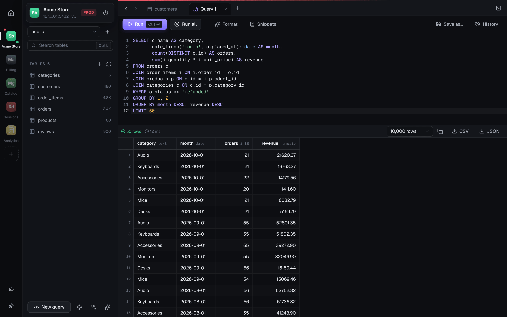
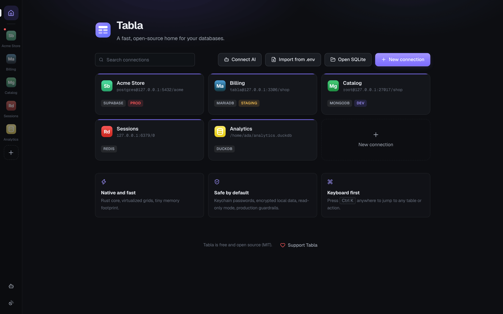
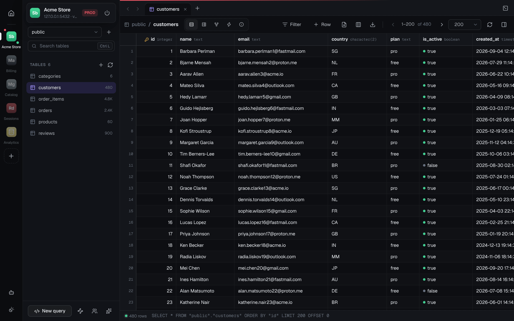
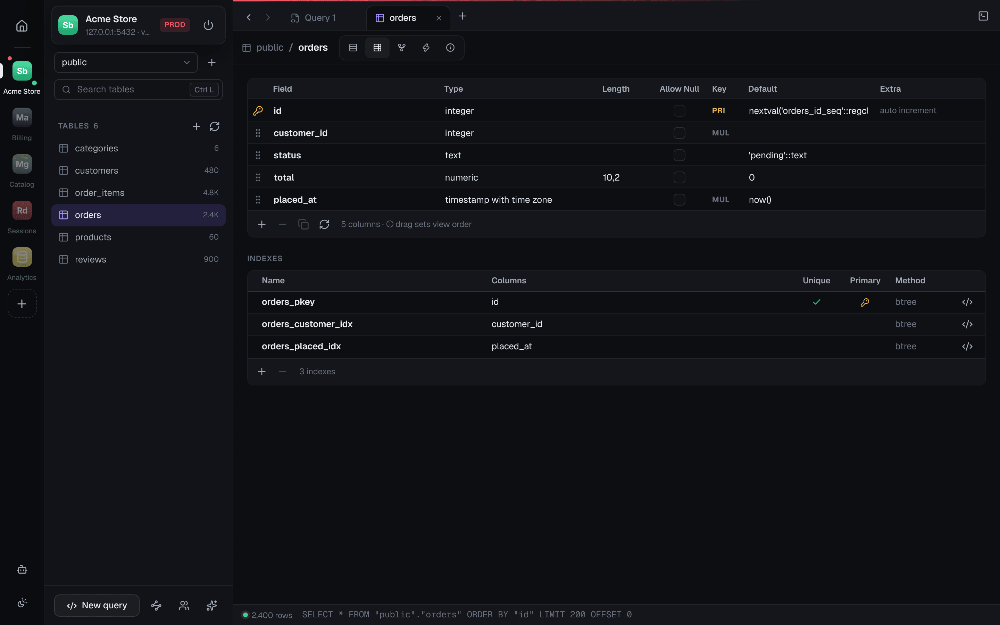
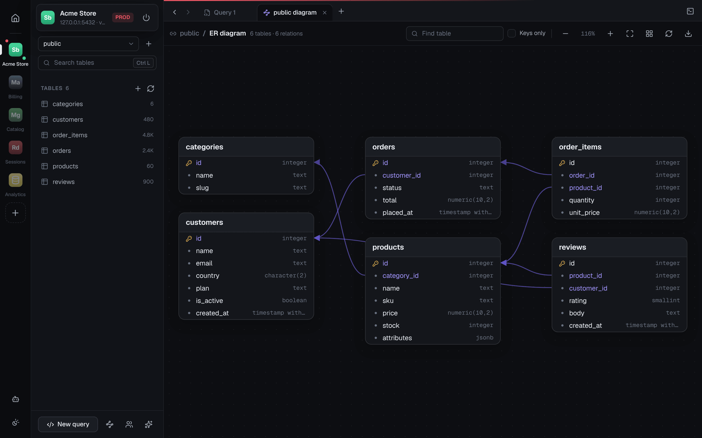

<div align="center">

# Tabla

**Every database. One beautiful app. Free forever.**

A fast, native, open-source database client for macOS, Windows and Linux,
for PostgreSQL, MySQL, MariaDB, SQL Server, Oracle, ClickHouse, SQLite, DuckDB,
MongoDB, Redis and the clouds they run on.

[Download](https://github.com/naylinndev/tabla/releases/latest) · [Docs](#features) · [Releases](https://github.com/naylinndev/tabla/releases) · [Security](SECURITY.md) · [Support](#support-tabla)

[](LICENSE)
[](https://github.com/naylinndev/tabla/actions/workflows/ci.yml)
[](#install)
[](https://tauri.app)
[](CONTRIBUTING.md)

`No paywall. No tab limits. No telemetry.`

<br />



</div>

---

## Screenshots

<table>
  <tr>
    <td width="50%"><br /><sub><b>All your databases in one place.</b> Tag connections as production, staging or dev.</sub></td>
    <td width="50%"><br /><sub><b>A fast data grid.</b> Edit cells, filter, sort and page through large tables.</sub></td>
  </tr>
  <tr>
    <td width="50%"><br /><sub><b>Visual structure editing.</b> Columns, defaults and indexes, with the SQL shown first.</sub></td>
    <td width="50%"><br /><sub><b>ER diagrams.</b> See how every table relates, and export it as SVG.</sub></td>
  </tr>
</table>

## Features

- **Native and light.** Rust core with a React UI on Tauri. The app is roughly 10 MB, not 150 MB.
- **Built for live production databases.** Connect through **SSH tunnels** (private key with passphrase, SSH agent, or password) with host-key verification, and use **TLS client certificates** (CA, client cert and key).
- **Structure editing.** Add, rename, retype and drop columns, change nullability and defaults, and **drag and drop to reorder** them. Tabla always shows the exact SQL first; Postgres changes run in one transaction.
- **Databases and schemas.** Create a database (MySQL encoding and collation included) or schema from the sidebar. Built-in ones like `mysql`, `pg_catalog` or MongoDB's `admin` are listed apart under *System* and open read-only, so nobody edits them by mistake.
- **Connect your AI.** Tabla is an **MCP server** (`tabla mcp`): Claude Code, Cursor, Claude Desktop, Windsurf and VS Code can read the databases you choose. AI access is read-only, guarded, and off by default for every connection.
- **Easy connections.** Import connections from a project's `.env` files (`DATABASE_URL` and similar), paste a URL, or follow step-by-step guides for each provider. Connection errors are explained in plain language with fix steps.
- **Spreadsheet-style editing.** Double-click a cell to edit, insert and delete rows, then review and commit everything in one transaction with <kbd>⌘ S</kbd>.
- **Safe writes.** Every UPDATE or DELETE must match exactly one row, or the whole batch rolls back.
- **Filters without SQL.** Stack conditions (`=`, `contains`, `in`, `is null` and more) or switch to a raw `WHERE` clause.
- **SQL editor.** Syntax highlighting, autocomplete for tables and columns, formatting, run the statement under the cursor (<kbd>⌘ ↵</kbd>) or the whole script (<kbd>⌘ ⇧ ↵</kbd>), and see multiple result sets.
- **Query history** for each connection, and query tabs that are kept between sessions.
- **Row inspector** with pretty-printed JSON and editable fields.
- **Structure view** showing columns, types, defaults, primary keys and indexes.
- **Several connections open at once,** switchable from the left rail.
- **Command palette** (<kbd>⌘ K</kbd>) to jump to any table, connection or action.
- **Export** results and table pages to CSV or typed JSON, and **import CSV** into any table (auto column mapping, one transaction).
- **Relations and triggers.** See foreign keys both ways, add or drop them, and click a foreign-key value to jump to the referenced row. List, inspect, enable, disable and drop triggers.
- **Users and privileges.** Accounts, grants, password changes, role attributes, grant/revoke presets, and a one-click **read-only user** (ideal for AI tools and dashboards).
- **Table info.** Engine, collation, sizes, row counts, auto increment and highlighted create syntax.
- **Console.** A live log of every statement Tabla sends to the server, with timing and errors (passwords masked, never written to disk).
- **Table actions.** Rename, duplicate, truncate and delete tables, always with the SQL shown first and type-to-confirm for destructive actions.
- **Redis.** Key browser with types and TTLs, typed editors for strings (JSON aware), hashes, lists, sets, sorted sets and streams, and a CLI that asks before writes on production.
- **MongoDB.** Databases and collections, a document grid with filters, sort and projection, a JSON editor that accepts mongosh syntax (ObjectId, ISODate…), indexes, and a mongosh-style shell that asks before writes.
- **DuckDB.** Open a `.duckdb` file (or `:memory:`) and query Parquet, CSV and JSON files directly, with lists, structs and maps shown as readable values.
- **Productive grid.** Duplicate rows (⌘D), hide or reorder columns, follow foreign keys, back/forward between tabs.
- **Copy for AI.** Copy a schema as an AI-ready prompt, or copy a failing query together with its error and related tables.
- **Environment tags and production guardrails.** Production connections get a red accent and ask for confirmation before committing changes.
- **Read-only mode** for each connection, enforced on the database server, not only in the UI.
- **Dark and light themes** (or follow the system), with native vibrancy on macOS.
- **Unlimited tabs, windows and connections.** Nothing is paywalled.

## Install

**Homebrew (macOS):**

```bash
brew tap naylinndev/tabla
brew trust --cask naylinndev/tabla/tabla
brew install --cask tabla
```

Recent Homebrew versions only load casks from third-party taps you have
trusted, hence the `brew trust` line. This also puts `tabla` on your PATH, so
AI tools can run `tabla mcp`. The app is signed and notarized by Apple, and it
updates itself from inside the app.

Already installed Tabla from the DMG? Add `--force` to let Homebrew take over
the existing app.

Maintainers: release and tap setup is described in [packaging/homebrew](packaging/homebrew/README.md).

**Direct download:** grab the `.dmg` (macOS), `.msi` (Windows) or `.AppImage`/`.deb` (Linux) from [Releases](https://github.com/naylinndev/tabla/releases).

**From source:** see [Development](#development).

## Supported databases

| Engine / service | Status | Notes |
| --- | --- | --- |
| PostgreSQL 10+ | Supported | Schemas, views, materialized views |
| MySQL 5.7+ / 8.x | Supported | |
| MariaDB | Supported | Uses the MySQL driver |
| SQLite 3 | Supported | Opens local files; read-only option |
| Redis / Valkey / KeyDB | Supported | Key browser, typed editors, CLI; Upstash and Redis Cloud presets |
| CockroachDB | Supported | PostgreSQL wire protocol |
| YugabyteDB (YSQL) | Supported | PostgreSQL wire protocol |
| Supabase · Neon · Timescale · Amazon RDS / Aurora | Supported | Hosted PostgreSQL / MySQL |
| PlanetScale · TiDB Cloud | Supported | Hosted MySQL protocol |
| Amazon Redshift | Beta | Browsing and queries |
| SQL Server · Azure SQL | Supported | Native TDS driver |
| ClickHouse · ClickHouse Cloud | Supported | HTTP interface (8123, or 8443 with TLS); no transactions |
| DuckDB | Supported | Local files or `:memory:`; query Parquet, CSV and JSON files directly |
| Oracle 19c+ · Amazon RDS for Oracle | Supported | Uses Oracle Instant Client, which Tabla can install for you |
| MongoDB · MongoDB Atlas | Supported | Collections, document grid and JSON editor, indexes, mongosh-style shell |

Every connection can go through an **SSH tunnel**, for databases on a VPS or
behind a bastion host, and can use **TLS client certificates**.

Each provider in the **New connection** dialog shows step-by-step instructions
for finding its credentials. You can also paste a connection URL
(`postgres://…`, `mysql://…`) and Tabla fills in the form.

## Security

Tabla connects straight to your database and touches nothing else.

- **Passwords are stored only in your OS keychain**: macOS Keychain, Windows
  Credential Manager, or Secret Service (GNOME Keyring / KWallet) on Linux.
  They are never written to disk by Tabla and never returned to the UI.
- **Your data is encrypted at rest.** Connection profiles (host, port, user,
  database, never the password) and the app's own data (query history, open
  query tabs, saved queries, filters) are encrypted with AES-256-GCM. The key is
  random, generated on first launch and kept in the OS keychain, so another
  program that opens Tabla's files sees only ciphertext. Nothing is kept in the
  web view's storage. Files are written owner-only (`0600`, folder `0700`) in your
  user config directory:
  - macOS: `~/Library/Application Support/dev.tabla.desktop/`
  - Windows: `%APPDATA%\dev.tabla.desktop\`
  - Linux: `~/.config/dev.tabla.desktop/`

  Data leaves Tabla only when you export it (always through a "Save as" dialog)
  or copy it. Limits: on macOS the keychain asks you before giving the key to any other app; on
  Windows and Linux, a program already running as your user can ask the keychain
  for it, so keep untrusted software off your account. If no keychain is
  available, files stay owner-only but unencrypted, and an encrypted file is never
  replaced with a plain one.
- **TLS** is supported with `prefer`, `require` and `verify-full` (CA plus hostname)
  modes, using rustls, plus custom CA and client certificate/key files (only their paths are stored).
- **SSH tunnels** verify server host keys against `~/.ssh/known_hosts` (never modified)
  and Tabla's own `known_hosts`. Unknown hosts are trusted on first use, and a **changed key is always refused**.
  SSH passwords and key passphrases live in the keychain; private keys are read from disk and never copied.
- **AI access (MCP) is opt-in per connection and read-only.** Each AI query must be a
  single read statement (SELECT/WITH/SHOW/EXPLAIN), known escape hatches are blocked, and it runs in a
  read-only transaction with a timeout that is always rolled back. For a hard guarantee, share
  a connection that uses a database user with only `SELECT` rights. DuckDB AI queries also run with
  file and network access switched off, so they can only read the database itself. On Oracle,
  Oracle's own parser must classify the statement as a query, and it runs in a read-only transaction.
  Redis and MongoDB connections open read-only for AI and accept only an allowlist of reads
  (GET, HGETALL, SCAN…; find, aggregate without `$out`/`$merge`, countDocuments, distinct).
- **Production guardrails.** Connections tagged *production* show a red accent and
  ask before committing data or structure changes. Every row edit must match exactly one row.
- **Locked-down web layer.** A strict Content Security Policy, no remote
  content, and minimal Tauri permissions. All database, file and dialog access
  goes through a small set of Rust commands. File export always goes through
  a native "Save as" dialog.
- **No telemetry, no analytics, no accounts.** The only network request Tabla
  makes on its own is a daily update check against GitHub Releases (a plain
  GET, no identifiers), which you can turn off under **Appearance → Updates**.
  DuckDB extensions are only downloaded when you run `INSTALL` yourself, and
  Oracle Instant Client only when you click **Install Instant Client** (it
  comes straight from oracle.com).
  Updates are downloaded only when you click **Install and restart**, and are
  installed only if they carry a valid signature from Tabla's release key.

Found a vulnerability? Please open a private
[security advisory](https://github.com/naylinndev/tabla/security/advisories/new)
instead of a public issue.

## Connect your AI (MCP)

Open **Connect AI** (the robot icon in the left rail), switch on the connections
your AI may read, then add Tabla to your tool. For example, in Claude Code:

```bash
claude mcp add tabla -- "/Applications/Tabla.app/Contents/MacOS/tabla" mcp
```

Cursor, Claude Desktop, Windsurf and VS Code use the same command and `["mcp"]`
argument in their MCP config. The dialog shows the exact snippet for your system.
Tools exposed: `list_connections`, `get_schema`, `describe_table` and `run_query` (read-only).
On Redis, `run_query` takes one read command (`HGETALL user:1`); on MongoDB, one
mongosh-style read (`db.orders.find({status: "paid"}).limit(20)`).
DuckDB allows only one program to write to a file, so an AI tool can read a DuckDB
database while Tabla has it open only if that connection is set to read-only.

## Keyboard shortcuts

| Action | macOS | Windows / Linux |
| --- | --- | --- |
| Command palette | <kbd>⌘ K</kbd> | <kbd>Ctrl K</kbd> |
| Home (all connections) | <kbd>⌘ 0</kbd> | <kbd>Ctrl 0</kbd> |
| New query tab | <kbd>⌘ T</kbd> | <kbd>Ctrl T</kbd> |
| Close tab | <kbd>⌘ W</kbd> | <kbd>Ctrl W</kbd> |
| Switch tab | <kbd>⌘ 1–9</kbd>, <kbd>⌘ ⇧ [ ]</kbd> | <kbd>Ctrl 1–9</kbd> |
| New connection | <kbd>⌘ N</kbd> | <kbd>Ctrl N</kbd> |
| Search tables | <kbd>⌘ L</kbd> | <kbd>Ctrl L</kbd> |
| Run statement / selection | <kbd>⌘ ↵</kbd> | <kbd>Ctrl ↵</kbd> |
| Run all | <kbd>⌘ ⇧ ↵</kbd> | <kbd>Ctrl Shift ↵</kbd> |
| Format SQL | <kbd>⌘ ⇧ F</kbd> | <kbd>Ctrl Shift F</kbd> |
| Commit changes | <kbd>⌘ S</kbd> | <kbd>Ctrl S</kbd> |
| Refresh table | <kbd>⌘ R</kbd> | <kbd>Ctrl R</kbd> |
| Filter rows | <kbd>⌘ F</kbd> | <kbd>Ctrl F</kbd> |
| Row inspector | <kbd>⌘ I</kbd> | <kbd>Ctrl I</kbd> |
| Edit cell | <kbd>↵</kbd> or start typing | same |
| Duplicate row | <kbd>⌘ D</kbd> | <kbd>Ctrl D</kbd> |
| Console (query log) | <kbd>⌘ ⇧ C</kbd> | <kbd>Ctrl Shift C</kbd> |
| Back / forward | <kbd>⌘ ⌥ ← →</kbd> | <kbd>Ctrl Alt ← →</kbd> |
| Delete selected rows | <kbd>Delete</kbd> | same |

## Development

### Prerequisites

- [Node.js](https://nodejs.org) 20+ and [pnpm](https://pnpm.io) 9+
- [Rust](https://rustup.rs) (stable)
- Platform requirements for Tauri: see the [Tauri prerequisites](https://tauri.app/start/prerequisites/)
  - **Linux:** also `libdbus-1-dev` (keychain access)

### Run

```bash
pnpm install
pnpm tauri dev
```

### Build

```bash
pnpm tauri build
```

### Tests

The backend has integration tests that run against real servers. Each test is
skipped unless its environment variable is set:

```bash
cd src-tauri
TABLA_TEST_PG="localhost:5432:<user>:tabla_test" \
TABLA_TEST_MYSQL="localhost:3306:<user>:tabla_test" \
TABLA_TEST_SQLITE="/path/to/tabla_test.db" \
TABLA_TEST_MSSQL="localhost:1433:sa:tabla_test" TABLA_TEST_MSSQL_PASSWORD="…" \
TABLA_TEST_CLICKHOUSE="localhost:8123:default:tabla_test" TABLA_TEST_CLICKHOUSE_PASSWORD="…" \
TABLA_TEST_ORACLE="localhost:1521:<user>:FREEPDB1" TABLA_TEST_ORACLE_PASSWORD="…" \
TABLA_TEST_MONGO="localhost:27017:<user>:tabla_test" TABLA_TEST_MONGO_PASSWORD="…" \
TABLA_TEST_SSH="127.0.0.1:2222:<user>:/dir/with/test/keys" \
TABLA_CONFIG_DIR="$(mktemp -d)" \
cargo test
```

DuckDB tests always run (it's in-process). Oracle tests also need
[Instant Client](https://www.oracle.com/database/technologies/instant-client.html)
on the library path (`LD_LIBRARY_PATH` on Linux).

Use throwaway databases and a throwaway SSH server: the tests write to them.
`TABLA_CONFIG_DIR` keeps tests away from your real saved connections.

### Browser-driven UI tests (debug builds only)

`tabla bridge` serves the backend on `127.0.0.1:1430` so the real UI can be
driven in a normal browser. It needs a per-run token, accepts only the Vite dev
origin, and refuses to start without `TABLA_CONFIG_DIR`. It is not compiled
into release builds.

```bash
TABLA_BRIDGE_TOKEN=$(uuidgen) TABLA_CONFIG_DIR=$(mktemp -d) src-tauri/target/debug/tabla bridge
```

Then open `http://localhost:1420/?bridge=<token>` while `pnpm dev` is running.

### Project layout

```
src/                  React + TypeScript UI
  components/         Views: Home, Workspace, TableView, QueryView, DataGrid…
  lib/                API bindings, store, SQL helpers, provider presets
  styles/app.css      Design tokens and styles (dark + light)
src-tauri/            Rust backend
  src/config.rs       Connection profiles + keychain
  src/vault.rs        Encryption at rest (key in the keychain)
  src/db.rs           Drivers, metadata, paging, transactional edits
  src/alter.rs        Structure editing (ALTER TABLE per engine)
  src/ssh.rs          SSH tunnels + host key verification
  src/mcp.rs          `tabla mcp` server for AI assistants
  src/ai_guard.rs     Read-only SQL validation for AI queries
  src/commands.rs     Tauri commands exposed to the UI
  src/bridge.rs       Debug-only HTTP bridge for UI tests
```

## Contributing

Issues and pull requests are welcome. See [CONTRIBUTING.md](CONTRIBUTING.md)
for setup, tests and guidelines, and [SECURITY.md](SECURITY.md) to report a
vulnerability privately.

## Support Tabla

Tabla is free and always will be. If it saves you time, you can support its
development with a Bitcoin donation:

<p align="center">
  
</p>

<p align="center"><code>bc1qjssygyqayth4sm8zcw7kq56ml3rvl3vsm24qq9</code></p>

Native SegWit (bc1q) address, on-chain Bitcoin only. Please double-check the
address in your wallet before sending. Starring the repo, reporting bugs and
sharing Tabla help a lot too.

## License

Tabla is free forever, for everyone, under the [MIT License](LICENSE):

```text
MIT License

Copyright (c) 2026 Tabla contributors

Permission is hereby granted, free of charge, to any person obtaining a copy
of this software and associated documentation files (the "Software"), to deal
in the Software without restriction, including without limitation the rights
to use, copy, modify, merge, publish, distribute, sublicense, and/or sell
copies of the Software, and to permit persons to whom the Software is
furnished to do so, subject to the following conditions:

The above copyright notice and this permission notice shall be included in all
copies or substantial portions of the Software.

THE SOFTWARE IS PROVIDED "AS IS", WITHOUT WARRANTY OF ANY KIND, EXPRESS OR
IMPLIED, INCLUDING BUT NOT LIMITED TO THE WARRANTIES OF MERCHANTABILITY,
FITNESS FOR A PARTICULAR PURPOSE AND NONINFRINGEMENT. IN NO EVENT SHALL THE
AUTHORS OR COPYRIGHT HOLDERS BE LIABLE FOR ANY CLAIM, DAMAGES OR OTHER
LIABILITY, WHETHER IN AN ACTION OF CONTRACT, TORT OR OTHERWISE, ARISING FROM,
OUT OF OR IN CONNECTION WITH THE SOFTWARE OR THE USE OR OTHER DEALINGS IN THE
SOFTWARE.
```

<div align="center">

**Your data, your tools, your rules.**

</div>
